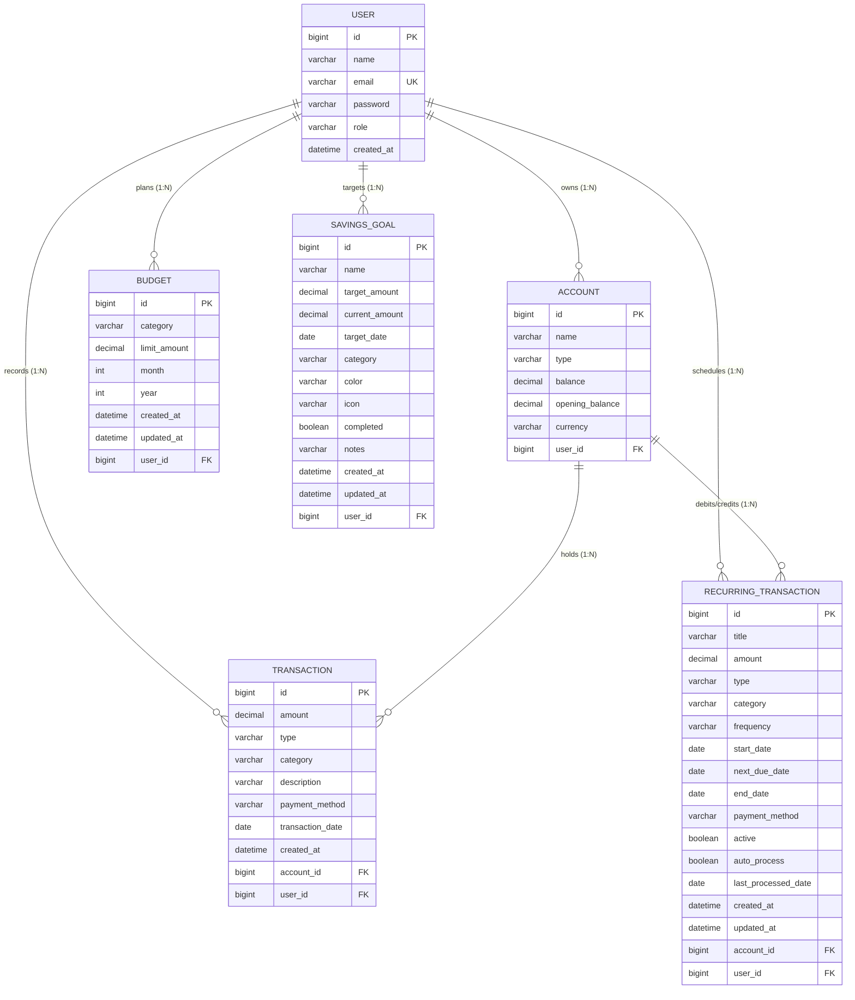

# 💰 ApexFinance API Service

A high-performance, enterprise-grade Personal Finance Management RESTful Microservice API built with **Spring Boot 4 / Java 21**, **Spring Security & Stateless JWT**, **Spring Data JPA**, **Hibernate**, and **PostgreSQL (Neon Serverless)**.

The service provides comprehensive personal financial management, featuring multi-account ledgers, atomic transaction processing with automatic balance reconciliation, inter-account fund transfers, category-based monthly budgets with threshold alerts, scheduled recurring transactions & subscriptions, milestone-driven savings goals, AI spending insights, financial reports, and CSV / JSON data import/export.

---

## 🛠️ Tech Stack & Dependencies

* **Language**: Java 21 (LTS)
* **Framework**: Spring Boot (`spring-boot-starter-webmvc`, `spring-boot-starter-data-jpa`, `spring-boot-starter-validation`)
* **Security & Authentication**: Spring Security 6, Stateless JWT (`io.jsonwebtoken:jjwt-api:0.12.6`), BCrypt Password Encoder
* **Database & ORM**: PostgreSQL (`org.postgresql:postgresql`), Hibernate, Spring Data JPA, HikariCP Connection Pooling
* **API Documentation**: SpringDoc OpenAPI 3 / Swagger UI (`springdoc-openapi-starter-webmvc-ui:2.8.13`)
* **Build Tool**: Maven Wrapper (`mvnw` / `mvnw.cmd`)
* **Containerization**: Multi-stage Dockerfile (`eclipse-temurin:21-jdk` -> `eclipse-temurin:21-jre`)
* **Cloud Deployment**: Render Web Service (`render.yaml`) with dynamic `$PORT` binding

---

## 🌟 Key Functional Modules

1. **🔐 Authentication & User Isolation (`/api/auth`)**:
   - Secure registration and login using BCrypt password hashing.
   - Stateless JWT Bearer token generation and verification (`app.jwt.secret`, `86400000ms` / 24h validity).
   - Dynamic user scoping: All financial data (accounts, transactions, budgets, goals, recurring rules) is strictly isolated to the authenticated user.
2. **💳 Account Portfolio & Inter-Account Transfers (`/api/accounts`)**:
   - Support for multiple account types: `BANK`, `CASH`, `SAVINGS`, `CREDIT_CARD`, `INVESTMENT`.
   - Opening balance tracking and real-time ledger balance calculations.
   - Atomic fund transfers between accounts (`POST /api/accounts/transfer`) with optional currency conversion amounts—adjusting balances without distorting income/expense metrics.
3. **📊 Atomic Transaction Processing & Multi-Filter Ledger (`/api/transactions`)**:
   - Types: `INCOME`, `EXPENSE`, `TRANSFER`.
   - Atomic balance updates: Adjusts account balances automatically within `@Transactional` boundaries upon creation, modification, or deletion, backed by insufficient balance safeguards.
   - Dynamic search & filtering powered by JPA Specifications (`search`, `type`, `category`, `accountId`, `minAmount`, `maxAmount`, `startDate`, `endDate`).
   - Pageable sorting and pagination.
   - Multipart spreadsheet CSV import (`/import-csv`) and filtered CSV export (`/export/csv`).
4. **🎯 Category Budgeting & Threshold Alerts (`/api/budgets`)**:
   - Monthly category limit allocations with unique user-category-period constraints.
   - Live budget health monitoring (`/status`) with automated threshold calculation:
     - `NORMAL`: < 80% spent
     - `WARNING`: 80% – 99.9% spent
     - `EXCEEDED`: ≥ 100% spent
5. **🔄 Scheduled Recurring Transactions (`/api/recurring-transactions`)**:
   - Automated tracking for subscriptions, utility bills, rent, and salaries.
   - 6 recurrence frequencies: `DAILY`, `WEEKLY`, `BIWEEKLY`, `MONTHLY`, `QUARTERLY`, `YEARLY`.
   - Automatic next due date projection, single schedule manual processing (`/{id}/process`), and batch due processing (`/process-due`).
6. **🏆 Milestone-Driven Savings Goals (`/api/savings-goals`)**:
   - Set savings targets with deadlines, category tags, and custom visual accents.
   - Direct fund contributions (`/{id}/contribute`) from any user account, deducting the account balance and crediting the goal atomically.
7. **📈 Financial Analytics & Executive Dashboard (`/api/dashboard`)**:
   - Aggregated Net Worth, Period Income, Period Expense, and Net Cash Flow.
   - Category expense distribution with percentage breakdowns.
   - Multi-month income vs. expense historical trend trajectories.
8. **🧠 AI-Driven Spending Insights (`/api/insights`)**:
   - Financial Health Score evaluation (0–100 scale, A+ through F grades).
   - Anomaly detection, top expense category warnings, recurring expense ratios, and personalized savings tips.
9. **📑 Comprehensive Reporting & Backup (`/api/reports`)**:
   - Monthly and yearly financial cash flow summaries.
   - Full data backup export (`/export/json`) bundling accounts, transactions, budgets, recurring rules, and savings goals into a single portable JSON document.
   - CSV financial ledger generation.
10. **🔔 Live Dynamic Notifications (`/api/notifications`)**:
    - Centralized alert notifications for budget threshold warnings, upcoming recurring payments, and account alerts.

---

## 📂 Architecture & Directory Structure

```
finance/
├── Dockerfile                              # Multi-stage production container build
├── render.yaml                             # Infrastructure-as-code cloud deployment
├── pom.xml                                 # Maven dependencies & build plugins
├── mvnw / mvnw.cmd                         # Maven wrapper executables
└── src/
    ├── main/
    │   ├── java/com/example/finance/
    │   │   ├── FinanceApplication.java     # Main application bootstrap
    │   │   ├── config/
    │   │   │   ├── OpenApiConfig.java      # OpenAPI 3 specification & Bearer Auth
    │   │   │   ├── SwaggerConfig.java      # Browser auto-launch for Swagger UI
    │   │   │   └── security/
    │   │   │       ├── CustomUserDetailsService.java
    │   │   │       ├── JwtAuthenticationEntryPoint.java
    │   │   │       ├── JwtAuthenticationFilter.java
    │   │   │       ├── JwtTokenProvider.java
    │   │   │       ├── SecurityConfig.java
    │   │   │       └── UserPrincipal.java
    │   │   ├── controller/
    │   │   │   ├── AccountController.java
    │   │   │   ├── AuthController.java
    │   │   │   ├── BudgetController.java
    │   │   │   ├── DashboardController.java
    │   │   │   ├── InsightController.java
    │   │   │   ├── NotificationController.java
    │   │   │   ├── RecurringTransactionController.java
    │   │   │   ├── ReportController.java
    │   │   │   ├── SavingsGoalController.java
    │   │   │   ├── TransactionController.java
    │   │   │   └── UserController.java
    │   │   ├── service/
    │   │   │   ├── AccountService.java
    │   │   │   ├── AuthService.java
    │   │   │   ├── BudgetService.java
    │   │   │   ├── DashboardService.java
    │   │   │   ├── InsightService.java
    │   │   │   ├── NotificationService.java
    │   │   │   ├── RecurringTransactionService.java
    │   │   │   ├── ReportService.java
    │   │   │   ├── SavingsGoalService.java
    │   │   │   ├── TransactionService.java
    │   │   │   └── UserService.java
    │   │   ├── repository/
    │   │   │   ├── AccountRepository.java
    │   │   │   ├── BudgetRepository.java
    │   │   │   ├── RecurringTransactionRepository.java
    │   │   │   ├── SavingsGoalRepository.java
    │   │   │   ├── TransactionRepository.java
    │   │   │   ├── UserRepository.java
    │   │   │   ├── projection/             # High-performance DB projection interfaces
    │   │   │   └── specification/          # JPA Specifications for multi-criteria filters
    │   │   ├── entity/
    │   │   │   ├── Account.java
    │   │   │   ├── Budget.java
    │   │   │   ├── RecurrenceFrequency.java
    │   │   │   ├── RecurringTransaction.java
    │   │   │   ├── SavingsGoal.java
    │   │   │   ├── Transaction.java
    │   │   │   ├── TransactionType.java
    │   │   │   └── User.java
    │   │   ├── dto/
    │   │   │   ├── request/                # Inbound request records with Jakarta validation
    │   │   │   └── response/               # Outbound response records
    │   │   └── exception/
    │   │       └── GlobalExceptionHandler.java # Centralized @RestControllerAdvice
    │   └── resources/
    │       └── application.properties      # PostgreSQL, HikariCP, and JWT configuration
    └── test/                               # Unit & Slice Integration Tests (H2 in-memory)
```

---

## 🗄️ Relational Domain Model (ERD)



---

## ⚙️ Configuration & Environment Variables

The application is configured via `src/main/resources/application.properties` with fallback defaults and environment variable overrides:

| Property | Environment Variable | Default Value | Description |
|---|---|---|---|
| `server.port` | `PORT` | `8080` | Port for the HTTP web server |
| `spring.datasource.url` | `SPRING_DATASOURCE_URL` | Neon PostgreSQL JDBC URL | PostgreSQL connection JDBC string |
| `spring.datasource.username` | `SPRING_DATASOURCE_USERNAME` | `neondb_owner` | Database username |
| `spring.datasource.password` | `SPRING_DATASOURCE_PASSWORD` | *configured* | Database password |
| `app.jwt.secret` | `JWT_SECRET` | *256-bit Hex String* | Secret key for signing HMAC-SHA256 JWTs |
| `app.jwt.expiration-ms` | `JWT_EXPIRATION_MS` | `86400000` | JWT validity duration in milliseconds (24h) |

### Local Database Setup (Optional Local PostgreSQL)
If you prefer running a local PostgreSQL instance instead of Neon:
```sql
CREATE DATABASE financedb;
```
Then set:
```properties
spring.datasource.url=jdbc:postgresql://localhost:5432/financedb
spring.datasource.username=postgres
spring.datasource.password=yourpassword
```

---

## 🚀 Getting Started

### Prerequisites
* **Java 21 JDK** or newer installed (`java -version`)
* **Maven 3.9+** (or use the included `./mvnw` wrapper)
* **PostgreSQL** database (or default connection to Neon cloud)

### Run Locally with Maven
1. **Clone & Navigate**:
   ```bash
   cd finance
   ```
2. **Build & Run**:
   - **Linux / macOS**:
     ```bash
     ./mvnw spring-boot:run
     ```
   - **Windows PowerShell / CMD**:
     ```powershell
     .\mvnw.cmd spring-boot:run
     ```
3. Once booted, the service is available at `http://localhost:8080`.
4. Swagger UI will automatically open in your default browser at:
   ```
   http://localhost:8080/swagger-ui/index.html
   ```

### Run with Docker
1. **Build Container**:
   ```bash
   docker build -t apex-finance-api .
   ```
2. **Run Container**:
   ```bash
   docker run -p 8080:8080 \
     -e SPRING_DATASOURCE_URL="jdbc:postgresql://your-host:5432/neondb?sslmode=require" \
     -e SPRING_DATASOURCE_USERNAME="your-user" \
     -e SPRING_DATASOURCE_PASSWORD="your-password" \
     -e JWT_SECRET="your-256-bit-hex-key" \
     apex-finance-api
   ```

---

## 📡 API Endpoints Specification

All endpoints under `/api/**` (except `/api/auth/**`, `/swagger-ui/**`, and `/v3/api-docs/**`) require an `Authorization: Bearer <token>` header obtained from `/api/auth/login`.

### 1. Authentication Endpoints (`/api/auth`)
| Method | Endpoint | Description | Request Body | Auth Required |
|---|---|---|---|---|
| `POST` | `/api/auth/register` | Register new user account | `RegisterRequest` | No |
| `POST` | `/api/auth/login` | Authenticate and obtain JWT token | `LoginRequest` | No |
| `GET` | `/api/auth/me` | Fetch authenticated user profile | *None* | **Yes** |

### 2. Account Endpoints (`/api/accounts`)
| Method | Endpoint | Description | Request Body | Auth Required |
|---|---|---|---|---|
| `POST` | `/api/accounts` | Create financial account | `AccountRequest` | **Yes** |
| `GET` | `/api/accounts` | List all accounts of authenticated user | *None* | **Yes** |
| `GET` | `/api/accounts/{id}` | Get account details by ID | *None* | **Yes** |
| `PUT` | `/api/accounts/{id}` | Update account metadata / balance | `AccountUpdateRequest` | **Yes** |
| `DELETE` | `/api/accounts/{id}` | Delete account | *None* | **Yes** |
| `POST` | `/api/accounts/transfer` | Atomic transfer between accounts | `TransferRequest` | **Yes** |

### 3. Transaction Endpoints (`/api/transactions`)
| Method | Endpoint | Description | Parameters / Body | Auth Required |
|---|---|---|---|---|
| `POST` | `/api/transactions` | Create transaction & adjust balance | `TransactionRequest` | **Yes** |
| `GET` | `/api/transactions` | Search & paginate transactions | `search, type, category, accountId, minAmount, maxAmount, startDate, endDate, page, size, sortBy, sortDir` | **Yes** |
| `GET` | `/api/transactions/{id}` | Get transaction by ID | *None* | **Yes** |
| `PUT` | `/api/transactions/{id}` | Update transaction & recalculate balance | `TransactionUpdateRequest` | **Yes** |
| `DELETE` | `/api/transactions/{id}` | Delete transaction & revert balance | *None* | **Yes** |
| `POST` | `/api/transactions/import-csv` | Bulk import transactions from CSV | `file` (multipart/form-data) | **Yes** |
| `GET` | `/api/transactions/export/csv` | Download filtered transactions as CSV | Same filter parameters as `GET /api/transactions` | **Yes** |

### 4. Budget Endpoints (`/api/budgets`)
| Method | Endpoint | Description | Parameters / Body | Auth Required |
|---|---|---|---|---|
| `POST` | `/api/budgets` | Set or update monthly category budget | `BudgetRequest` | **Yes** |
| `GET` | `/api/budgets` | List budgets (optional month/year filters) | `month, year` | **Yes** |
| `GET` | `/api/budgets/{id}` | Get budget by ID | *None* | **Yes** |
| `DELETE` | `/api/budgets/{id}` | Delete budget limit | *None* | **Yes** |
| `GET` | `/api/budgets/status` | Live spending status & threshold alerts | `month, year` | **Yes** |

### 5. Recurring Transaction Endpoints (`/api/recurring-transactions`)
| Method | Endpoint | Description | Request Body | Auth Required |
|---|---|---|---|---|
| `GET` | `/api/recurring-transactions` | List all recurring schedules | *None* | **Yes** |
| `POST` | `/api/recurring-transactions` | Create recurring rule | `RecurringTransactionRequest` | **Yes** |
| `GET` | `/api/recurring-transactions/{id}` | Get recurring schedule by ID | *None* | **Yes** |
| `PUT` | `/api/recurring-transactions/{id}` | Update recurring schedule | `RecurringTransactionRequest` | **Yes** |
| `DELETE` | `/api/recurring-transactions/{id}` | Delete recurring schedule | *None* | **Yes** |
| `POST` | `/api/recurring-transactions/{id}/process` | Post individual recurring item to ledger | *None* | **Yes** |
| `POST` | `/api/recurring-transactions/process-due` | Process all schedules due up to today | *None* | **Yes** |

### 6. Savings Goals Endpoints (`/api/savings-goals`)
| Method | Endpoint | Description | Request Body | Auth Required |
|---|---|---|---|---|
| `GET` | `/api/savings-goals` | List all savings targets | *None* | **Yes** |
| `POST` | `/api/savings-goals` | Create savings target | `SavingsGoalRequest` | **Yes** |
| `GET` | `/api/savings-goals/{id}` | Get savings target by ID | *None* | **Yes** |
| `PUT` | `/api/savings-goals/{id}` | Update savings target | `SavingsGoalRequest` | **Yes** |
| `DELETE` | `/api/savings-goals/{id}` | Delete savings target | *None* | **Yes** |
| `POST` | `/api/savings-goals/{id}/contribute` | Deposit funds from account into goal | `GoalContributionRequest` | **Yes** |

### 7. Dashboard & Analytics Endpoints (`/api/dashboard`)
| Method | Endpoint | Description | Parameters | Auth Required |
|---|---|---|---|---|
| `GET` | `/api/dashboard/summary` | Aggregated net worth, cash flow & counts | `month, year` | **Yes** |
| `GET` | `/api/dashboard/category-breakdown` | Category distribution & percentages | `month, year` | **Yes** |
| `GET` | `/api/dashboard/monthly-trend` | Multi-month income vs. expense trend | `months` (default 6) | **Yes** |

### 8. AI Insights Endpoints (`/api/insights`)
| Method | Endpoint | Description | Parameters | Auth Required |
|---|---|---|---|---|
| `GET` | `/api/insights/spending` | Health score, anomalies & savings tips | *None* | **Yes** |

### 9. Reports & Backup Endpoints (`/api/reports`)
| Method | Endpoint | Description | Parameters | Auth Required |
|---|---|---|---|---|
| `GET` | `/api/reports/monthly` | Monthly cash flow statement | `year, month` | **Yes** |
| `GET` | `/api/reports/yearly` | Yearly financial report & 12-month curve | `year` | **Yes** |
| `GET` | `/api/reports/monthly/category` | Category-level expense totals | `year, month` | **Yes** |
| `GET` | `/api/reports/export/csv` | Download complete ledger as CSV | *None* | **Yes** |
| `GET` | `/api/reports/export/json` | Full JSON data backup | *None* | **Yes** |

### 10. Notification Endpoints (`/api/notifications`)
| Method | Endpoint | Description | Parameters | Auth Required |
|---|---|---|---|---|
| `GET` | `/api/notifications` | Dynamic budget alerts & bill reminders | *None* | **Yes** |

---

## 📋 Sample Payloads

### Inter-Account Transfer (`POST /api/accounts/transfer`)
```json
{
  "sourceAccountId": 1,
  "destinationAccountId": 2,
  "amount": 500.00,
  "destinationAmount": 500.00,
  "description": "Monthly transfer to high-yield savings",
  "transferDate": "2026-10-19"
}
```

### Recurring Transaction Schedule (`POST /api/recurring-transactions`)
```json
{
  "accountId": 1,
  "title": "Cloud Server Subscription",
  "amount": 49.99,
  "type": "EXPENSE",
  "category": "Utilities",
  "frequency": "MONTHLY",
  "startDate": "2026-10-01",
  "nextDueDate": "2026-11-01",
  "paymentMethod": "CREDIT_CARD",
  "description": "Production hosting infra",
  "active": true,
  "autoProcess": true
}
```

### Goal Contribution (`POST /api/savings-goals/{id}/contribute`)
```json
{
  "accountId": 1,
  "amount": 250.00,
  "notes": "Emergency fund allocation"
}
```

---

## 🔒 Security Architecture

```mermaid
flowchart TD
    Client[HTTP Client / Frontend] -->|Bearer JWT Header| Filter[JwtAuthenticationFilter]
    Filter -->|Extract & Validate Token| TokenProvider[JwtTokenProvider]
    TokenProvider -->|Valid Claims| UserDetails[CustomUserDetailsService]
    UserDetails -->|Load UserPrincipal| SecurityContext[SecurityContextHolder]
    SecurityContext --> Controller[Authenticated RestController]
    Filter -->|Invalid or Expired| EntryPoint[JwtAuthenticationEntryPoint (401 Unauthorized)]
```

* **Passwords**: Encrypted with BCrypt hashing algorithm (`10` rounds salt).
* **JWT Token**: Encoded with HMAC-SHA256 containing User ID, Email, and Roles.
* **CORS**: Configured in `SecurityConfig.java` to support local development ports (`localhost:*`, `127.0.0.1:*`) as well as production Vercel (`*.vercel.app`) and Render domains (`*.onrender.com`).

---

## 📖 Swagger Documentation UI

Once the application is running, inspect and interactively test every API endpoint via Swagger UI:
```
http://localhost:8080/swagger-ui/index.html
```
Raw OpenAPI v3 JSON schema is available at:
```
http://localhost:8080/v3/api-docs
```
